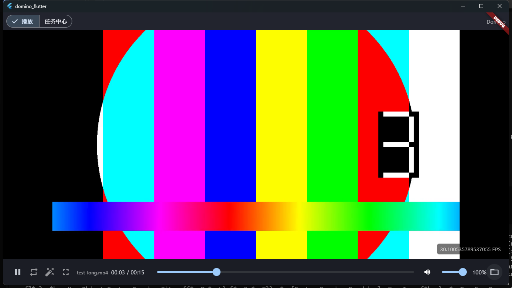

# Domino Player

跨平台视频**超分 + 美颜**播放器：**Flutter 前端**（当前 Windows 桌面）+ **可移植 C++ 引擎**（FFmpeg 解码 + NCNN Vulkan 超分）。

- **播放**：播放/暂停/seek/音量/循环、**GPU 着色器磨皮/美白/滤镜**（D3D11 HLSL，CPU 自动回退）、滤镜缩略图、动态宽高比、FPS 角标、系统文件选择框。
- **实时超分（实验性）**：播放页手动切换关闭/1080p/2K/4K；解码/SR 已移到原生工作线程，720p 源 1080p 约 29 FPS，2K/4K 分别约 15/6 FPS（详见 `docs/plan-sr-worker-2026-10.md`）。
- **超分任务中心**：新建/开始/暂停/断点续编/边播放（边编码边看）/删除，任务持久化。
- **引擎可移植**：`domino_core` 不含任何平台依赖（视频经 `IFrameOutput`、音频经 `AudioSink`），任意前端可链接（Windows 现用 WASAPI + Flutter 纹理）。

架构、约束与完成定义（DoD）见 [`AGENTS.md`](AGENTS.md)；当前进度与里程碑见 [`docs/roadmap.md`](docs/roadmap.md)。



## 下载（Windows 预编译包）

无需自行编译：到 [**Releases**](https://github.com/Rhett-12138/domino-player/releases) 下载
`domino-player-vX.Y.Z-win64.zip`，解压后双击 `domino_flutter.exe` 即可运行（详见包内 `运行说明.txt`）。

- 需 64 位 Windows 10/11；超分需支持 Vulkan 的独立显卡。
- 若提示缺少 `VCRUNTIME140/MSVCP140`，安装 [Microsoft Visual C++ 可再发行组件 (x64)](https://aka.ms/vs/17/release/vc_redist.x64.exe)。
- 未签名 exe 首次运行可能触发 SmartScreen：点「更多信息 → 仍要运行」。

## 前置条件

- **Visual Studio 2022**（MSVC，含「使用 C++ 的桌面开发」+ C++ CMake 工具）
- **CMake** ≥ 3.20
- **Flutter SDK**（stable）
- 支持 **Vulkan** 的独立显卡（NCNN 超分）
- 预编译依赖置于 `libs/`（**git 忽略，需自行放置**）：
  - `libs/ffmpeg/ffmpeg-master-latest-win64-gpl-shared/`
  - `libs/ncnn/ncnn-20260526-windows-vs2022-shared/`

超分模型：`assets/models/sr/ncnn/RealESRGAN_General_x4_v3.{param,bin}`。

## 构建与运行

### Flutter 前端（主）

```bash
cd flutter
flutter run -d windows            # 开发运行（热重载）
flutter build windows --debug     # 产物：build/windows/x64/runner/Debug/domino_flutter.exe
```

引擎桥 DLL（`domino_engine.dll`）、FFmpeg/NCNN 运行库与模型由构建自动拷到 runner 目录，直接运行 exe 即可。

### C++ 引擎 + 单元测试

```bash
cmake -S . -B build
cmake --build build --target domino_tests
ctest --test-dir build -C Release --output-on-failure      # ~5s，应 0 failed
```

## 测试

| 层 | 命令 | 说明 |
|---|---|---|
| C++ 引擎 | `ctest --test-dir build -C Release` | decode/encode/task/player/config/beauty/frame_output/sr，headless |
| Flutter | `cd flutter && flutter test` | 纯 Dart，无需 DLL；用 `FakeEngine` 桩驱动 UI |

测试细节见 [`tests/README.md`](tests/README.md)。

## 目录结构

```
├── src/                  # 可移植 C++ 引擎（domino_core）
│   ├── engine.h          # IFrameOutput 视频输出抽象
│   ├── audio_interface.h # AudioSink 音频抽象（Windows=WASAPI，可注入）
│   ├── player.{h,cpp}    # 播放核心（解码/超分/调度/A·V 同步/seek）
│   ├── frame_output.*    # EngineFrameOutput：CPU 美颜 + 帧缓冲（Flutter 纹理用）
│   ├── beauty_math.h     # 美颜/滤镜纯数学（可单测）
│   └── decode / encode / sr / task / config / log
├── flutter/              # Flutter 前端
│   ├── lib/main.dart             # 播放页 + 首页（播放/任务中心）
│   ├── lib/core/engine.dart      # EngineApi 抽象 + domino_engine.dll FFI 绑定
│   ├── lib/core/format.dart      # 展示层纯函数
│   ├── lib/ui/task_center.dart   # 任务中心
│   ├── native/engine_bridge.*    # C++ 桥（extern "C" 导出 + Flutter 像素纹理 + 文件框 + 全屏）
│   └── test/                     # Dart 测试
├── tests/                # C++ 单测 + assets + GUI 自动化脚本
├── libs/                 # 依赖（ffmpeg/ncnn 本地放置，git 忽略）
├── assets/models/sr/ncnn/# 超分模型
└── docs/                 # roadmap / project-structure
```

## 文档

- [`AGENTS.md`](AGENTS.md) — 项目宪章：目标、硬约束、DoD、**已知坑**（改桥/引擎前必读）
- [`CONTRIBUTING.md`](CONTRIBUTING.md) — 贡献指南（环境/构建/DoD/提交规范）
- [`docs/roadmap.md`](docs/roadmap.md) — 当前状态与里程碑
- [`docs/project-structure.md`](docs/project-structure.md) — 分层与文件说明
- [`tests/README.md`](tests/README.md) — 测试策略

## 许可

本项目源码以 [MIT](LICENSE) 发布。第三方组件（FFmpeg / NCNN / Flutter / 模型权重）各有其许可，
**分发二进制前请先读** [`THIRD_PARTY_NOTICES.md`](THIRD_PARTY_NOTICES.md)（尤其 FFmpeg GPL 的传染性）。
