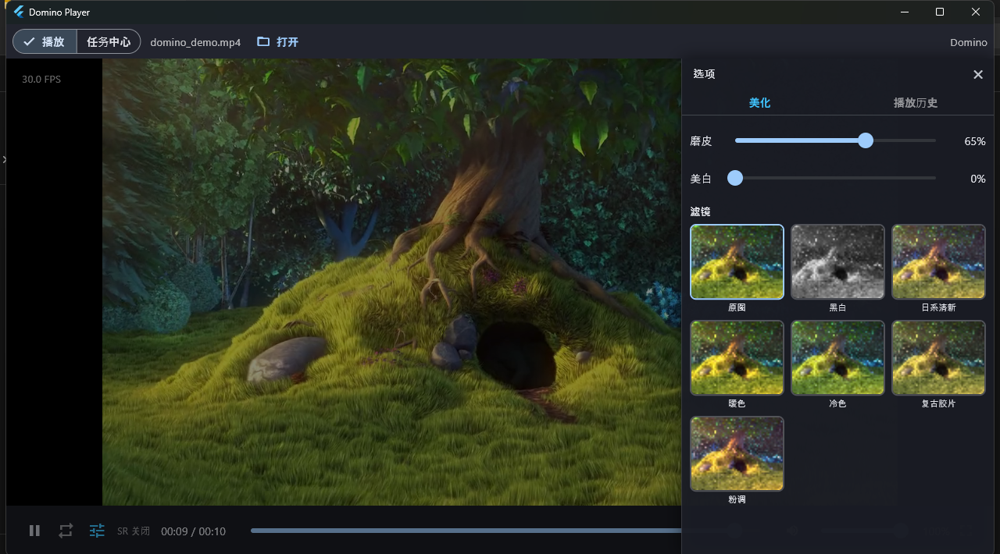
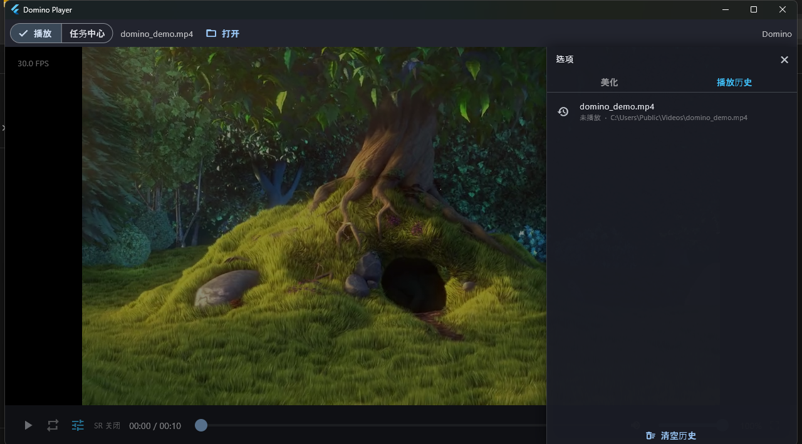
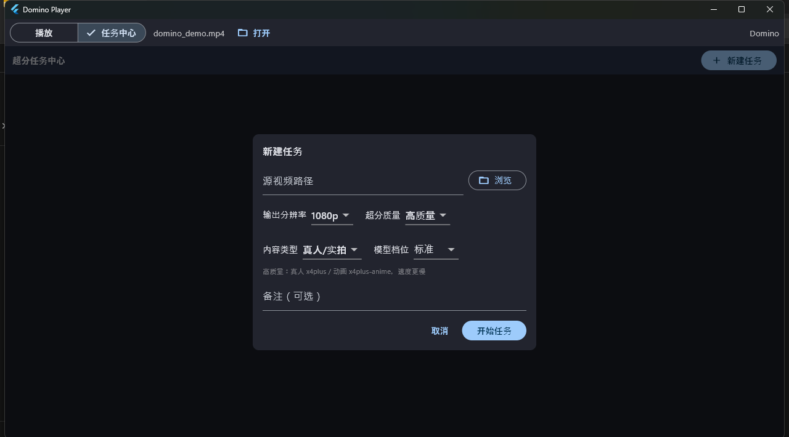
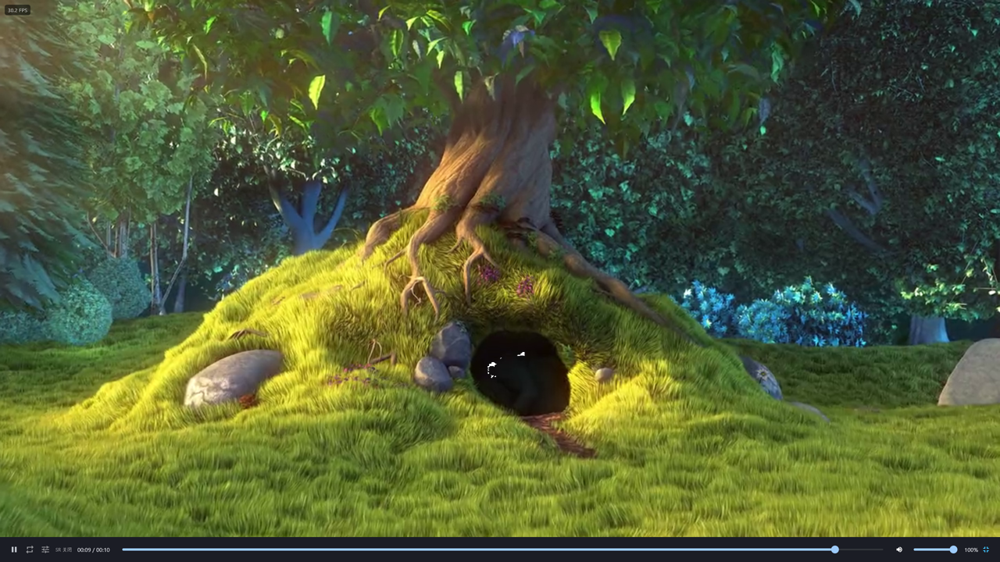

# Domino Player

跨平台视频**超分 + 美颜**播放器：**Flutter 前端**（当前 Windows 桌面）+ **可移植 C++ 引擎**（FFmpeg 解码 / 编码 + NCNN Vulkan 超分）。

当前重点是把「实时播放」和「离线超分任务」做成一套可用的桌面工具：播放页支持沉浸式全屏、侧边美化 / 播放历史、实时 SR；任务中心支持新建、暂停、断点续编、边播放和删除任务。


## 功能一览

### 播放与交互

- **本地视频播放**：FFmpeg 解码，音频经 WASAPI 输出，支持播放 / 暂停、seek、音量、循环、动态宽高比。
- **沉浸式全屏**：隐藏首页标签栏和播放页顶栏，只保留视频；控制条 3 秒无操作自动隐藏，移动鼠标 / 点击画面重新显示，`Esc` 或右下角按钮退出。
- **顶部文件栏**：当前文件名和「打开」按钮就在「播放 / 任务中心」标签旁；长文件名自动省略。
- **控制条**：播放 / 暂停、循环、选项、实时 SR、时间、可拉伸 seek、音量、全屏；全屏按钮固定在控制条最右侧，窄窗口也保持可见。
- **侧边选项面板**：从右侧滑入，合并「美化」和「播放历史」两个页签，不打断视频播放。
- **播放历史**：自动记录最近 20 个影片及播放位置，点击历史项重新打开并续播；数据保存在 `%APPDATA%\DominoPlayer\history.json`。
- **系统文件选择框**：通过 FFI 调用 Windows `IFileOpenDialog`，不额外引入文件选择插件。
- **FPS / 状态提示**：左上角显示 FPS；SR 失败、自动降档、打开失败都有界面反馈。

### 美颜与滤镜

- **GPU 着色器美颜**：D3D11 HLSL 两遍高斯磨皮 + 美白 / 滤镜，经 Flutter GPU surface 直接上屏；无 D3D11 或设置 `DOMINO_CPU_BEAUTY=1` 时回退 CPU 路径。
- **磨皮 / 美白**：各自独立滑杆和百分比，互不影响。
- **7 种滤镜**：原图、黑白、日常清新、暖色、净色、复古胶片、粉调；三列网格展示，缩略图按当前画面实时生成。
- **实时预览**：打开面板或调整磨皮 / 美白后自动刷新滤镜缩略图，方便对比效果。

### 实时超分（实验性）

- 播放页可切换 **SR 关闭 / 1080p / 2K / 4K**，由 NCNN Vulkan 实时推理。
- 解码和 SR 已移到原生 VideoWorker，UI 线程只负责取帧和呈现；seek 带 generation，避免旧帧回跳。
- 720p 源实时 1080p 约 **29.6 FPS**；2K / 4K 约 **15 / 5.9 FPS**，取决于显卡和片源。
- **自动降档**：4K / 2K 持续落后音频约 1 秒会降到 1080p；1080p 仍跟不上则关闭 SR。手动选档会清除自动降档状态并重试。
- 开启 SR 后仍可叠加 GPU 美颜和滤镜。

### 离线超分任务中心

- **新建任务**：选择源视频、输出分辨率、超分质量（快速 / 平衡 / 高质量）、内容类型（真人/实拍 / 动画）和模型档位（标准 / 高质量）。
- **任务管理**：开始、暂停、断点续编、边播放（编码产物边写边看）、删除；任务状态和进度实时刷新。
- **持久化**：任务信息写入 `meta.tsv`，包括质量档、内容类型、模型和 SR 输入策略；重启或续编时沿用，不会悄悄换模型。
- **断点续编**：取消或失败后保留续编分段，下次启动先合并再继续；主文件替换有备份和回滚。
- **编码设置**：输出 MP4 / fMP4，`faststart`；x264 CRF18 + preset slow，关闭 B 帧并启用 `zerolatency`，避免 fMP4 音视频起点偏移。
- **输出质量**：默认高质量 FullSource 输入（源分辨率，最高 1920 宽），4x 模型推理后用 Lanczos 缩放到目标分辨率；高质量模型档细节更好但更慢。

### 模型库

| 模型 | 用途 | 倍率 | 说明 |
|---|---|---:|---|
| `RealESRGAN_General_x4_v3` | 真人/实拍标准 | 4x | 通用 Real-ESRGAN，实时与离线默认标准模型 |
| `realesr-animevideov3-x2` | 动画标准 | 2x | 目标 ≤ 2x 源宽时自动选择 |
| `realesr-animevideov3-x3` | 动画标准 | 3x | 目标 ≤ 3x 源宽时自动选择 |
| `realesr-animevideov3-x4` | 动画标准 | 4x | 更大放大倍率 |
| `realesrgan-x4plus` | 真人/实拍高质量 | 4x | 输入上限 960，慢但细节更强 |
| `realesrgan-x4plus-anime` | 动画高质量 | 4x | 输入上限 960，动画线条更干净 |

- 动画标准会按 `目标宽 / 源宽` 自动选 x2 / x3 / x4；真人标准目前只有 x4。
- 高质量档 `x4plus` / `x4plus-anime` 的输入宽限制为 960，超出会先缩放，避免显存溢出。
- 模型文件和许可说明在 [`assets/models/sr/ncnn/`](assets/models/sr/ncnn/)；任务续编会沿用创建时选择的模型。

### 可移植引擎

- `domino_core` 不依赖 D3D11 / WASAPI：视频经 `IFrameOutput` 输出，音频经 `AudioSink` 注入，任意前端都可链接。
- Windows 使用 WASAPI + Flutter 纹理；后续移动端只需注入对应 `AudioSink` / 视频输出实现。
- Flutter 通过 `domino_engine.dll` 的 `extern "C"` FFI 桥调用引擎；GPU 美颜使用 D3D11 共享纹理上屏。
- A/V 同步按音频时钟和 PTS 呈现；暂停 / 恢复 / seek 都会重置时钟锚点。

## 截图

<p align="center">
  
  
</p>
<p align="center">
  
  
</p>



> 截图中的演示视频来自 Blender Foundation 的 *Big Buck Bunny*（CC BY 3.0），仅用于界面展示，不随仓库分发。

## 下载（Windows 预编译包）

无需自行编译：到 [**Releases**](https://github.com/Rhett-12138/domino-player/releases) 下载
`domino-player-vX.Y.Z-win64.zip`，解压后双击 `domino_flutter.exe` 即可运行（详见包内 `运行说明.txt`）。

- 需 64 位 Windows 10/11；超分需支持 Vulkan 的独立显卡。
- 若提示缺少 `VCRUNTIME140/MSVCP140`，安装 [Microsoft Visual C++ 可再发行组件 (x64)](https://aka.ms/vs/17/release/vc_redist.x64.exe)。
- 未签名 exe 首次运行可能触发 SmartScreen：点「更多信息 → 仍要运行」。

## 前置条件

- **Visual Studio 2022**（MSVC，含「使用 C++ 的桌面开发」+ C++ CMake 工具）
- **CMake** ≥ 3.20
- **Flutter SDK**（stable）
- 支持 **Vulkan** 的独立显卡（NCNN 超分）
- 预编译依赖置于 `libs/`（**git 忽略，需自行放置**）：
  - `libs/ffmpeg/ffmpeg-master-latest-win64-gpl-shared/`
  - `libs/ncnn/ncnn-20260526-windows-vs2022-shared/`

超分模型放在 `assets/models/sr/ncnn/`，包括标准、动画 x2/x3/x4 和高质量模型（见上表）。

## 构建与运行

### Flutter 前端（主）

```bash
cd flutter
flutter run -d windows            # 开发运行（热重载）
flutter build windows --debug     # 产物：build/windows/x64/runner/Debug/domino_flutter.exe
```

引擎桥 DLL（`domino_engine.dll`）、FFmpeg/NCNN 运行库与模型由构建自动拷到 runner 目录，直接运行 exe 即可。

### C++ 引擎 + 单元测试

```bash
cmake -S . -B build
cmake --build build --target domino_tests
ctest --test-dir build -C Release --output-on-failure      # ~5s，应 0 failed
```

## 测试

| 层 | 命令 | 说明 |
|---|---|---|
| C++ 引擎 | `ctest --test-dir build -C Release` | decode/encode/task/player/config/beauty/frame_output/sr，headless |
| Flutter | `cd flutter && flutter test` | 纯 Dart，无需 DLL；用 `FakeEngine` 桩驱动 UI |

当前 Flutter 测试覆盖：播放控制、全屏 / 自动隐藏、侧边面板、播放历史、美化布局、窄窗口布局、任务中心和 SR 状态等。测试细节见 [`tests/README.md`](tests/README.md)。

## 目录结构

```
├── src/                  # 可移植 C++ 引擎（domino_core）
│   ├── engine.h          # IFrameOutput 视频输出抽象
│   ├── audio_interface.h # AudioSink 音频抽象（Windows=WASAPI，可注入）
│   ├── player.{h,cpp}    # 播放核心（解码/超分/调度/A·V 同步/seek）
│   ├── frame_output.*    # 视频帧输出 / CPU 美颜
│   ├── beauty_math.h     # 美颜/滤镜纯数学（可单测）
│   └── decode / encode / sr / task / config / log
├── flutter/              # Flutter 前端
│   ├── lib/main.dart             # 播放页、首页、全屏、选项面板
│   ├── lib/core/engine.dart      # EngineApi 抽象 + domino_engine.dll FFI 绑定
│   ├── lib/core/history.dart     # 播放历史持久化
│   ├── lib/core/format.dart      # 展示层纯函数
│   ├── lib/ui/task_center.dart   # 任务中心
│   ├── native/engine_bridge.*    # C++ 桥（FFI + 纹理 + 文件框 + 全屏）
│   └── test/                     # Dart 测试
├── tests/                # C++ 单测 + assets + GUI 自动化脚本
├── libs/                 # 依赖（ffmpeg/ncnn 本地放置，git 忽略）
├── assets/models/sr/ncnn/# 超分模型
├── docs/screenshots/     # README 截图
└── docs/                 # roadmap / project-structure / plans
```

## 安全与隐私

- **离线运行**：播放、超分、美颜和任务编码都在本地完成；代码中没有遥测、账号系统或上传视频的接口。
- **本地数据**：播放历史写到 `%APPDATA%\DominoPlayer\history.json`，离线任务写到 `%APPDATA%\DominoPlayer\sr-tasks\`；删除对应目录即可清空。
- **无密钥**：仓库不包含 API Key、令牌、私钥或云服务凭据；FFmpeg / NCNN 运行库和模型二进制按各自许可获取。
- **路径建议**：本地构建/调试时不要把个人绝对路径写进源码或提交信息；模型/数据目录优先通过环境变量或本地未跟踪文件配置。
- **历史作者邮箱**：Git 历史中的提交作者信息会随仓库公开。如果不想公开个人邮箱，请在首次公开 / 强制推送前用 GitHub noreply 地址改写提交作者，或使用仓库的 `.mailmap` 做映射（`.mailmap` 只影响显示，不改变 Git 对象）。

第三方组件和模型许可见 [`THIRD_PARTY_NOTICES.md`](THIRD_PARTY_NOTICES.md)。特别注意 FFmpeg GPL 构建的分发约束。

## 已知限制

- 2K / 4K 实时 SR 还达不到稳定 30 FPS，复杂片源依赖自动降档；真正 4K 实时仍需要更轻量的模型或推理优化。
- 真人 2x/3x 暂未接入可用模型；动画 x2/x3 已支持，真人 1.5x 可用 2x 后缩放。
- `x4plus` / `x4plus-anime` 输入宽限制 960，质量更好但明显更慢；1080p→4K FullSource 中间帧较大，峰值内存约 1.9GB。
- 移动端尚未实机验证；引擎接口已按可移植方式拆分。
- 当前只提供 Windows 预编译包；其他平台需自行构建并注入 `AudioSink`。

## 文档

- [`AGENTS.md`](AGENTS.md) — 项目宪章：目标、硬约束、DoD、已知坑
- [`CONTRIBUTING.md`](CONTRIBUTING.md) — 贡献指南（环境/构建/DoD/提交规范）
- [`docs/roadmap.md`](docs/roadmap.md) — 当前状态与里程碑
- [`docs/project-structure.md`](docs/project-structure.md) — 分层与文件说明
- [`tests/README.md`](tests/README.md) — 测试策略

## 许可

本项目源码以 [MIT](LICENSE) 发布。第三方组件（FFmpeg / NCNN / Flutter / 模型权重）各有其许可，
**分发二进制前请先读** [`THIRD_PARTY_NOTICES.md`](THIRD_PARTY_NOTICES.md)（尤其 FFmpeg GPL 的传染性）。
